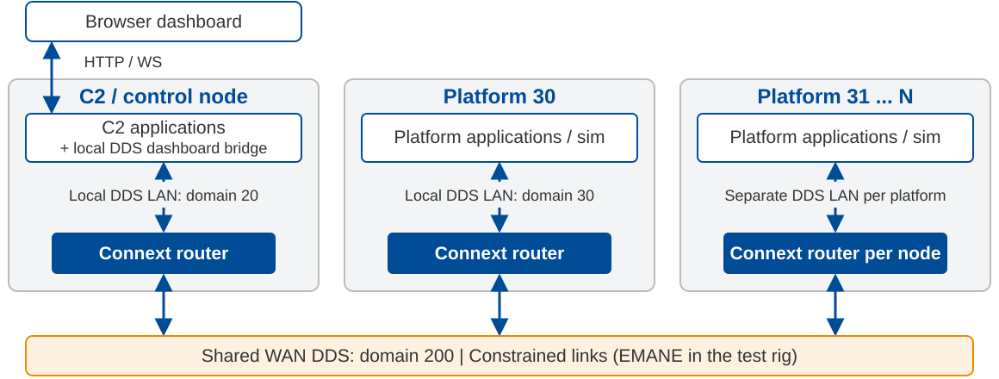

# Current system

**One router per node:** selected commands, status, health, and team data cross the WAN.

---

<!-- _class: compact isolation-matrix -->

# Isolation mechanisms

| Mechanism | Network | Discovery | Logical | Runtime changeable | Network bandwidth impact |
|---|:---:|:---:|:---:|:---:|---|
| VLANs / firewall rules | Network paths | — | — | Network admin | Limits discovery + data reach |
| Domain ID | Port ranges | Participant + endpoint | — | — | Scopes discovery + data |
| Domain tag | — | Participant + endpoint | — | — | Less endpoint discovery + data |
| DomainParticipant partitions | — | Participant + endpoint | Subsystem / team | Application | Less endpoint discovery + data |
| Publisher/Subscriber partitions | — | — | Groups of topics | Application | Less data; discovery remains |
| Topics | — | — | Topic | — | Discovery per endpoint; data per match |
| Content filters | — | — | Sample | Application | Less data if sender-filtered |
| Union discriminator | — | — | Sample (variant) | Application | Fewer endpoints: less discovery |

**Runtime changeable:** no DDS entity recreation.
**Bandwidth:** endpoint count drives discovery; sender-side selection reduces user data.

---

<!-- _class: compact -->

# Two strategies for data filtering

| | Control exposure | Control interest |
|---|---|---|
| Driver | Source controls data availability | User controls scope / filter of available data |
| Control | Enable additional routes or reporting topics | Expand subscriptions or content-filter criteria |
| Example | Enable routes based on mission state | Request data based on teams or location |
| Benefit | Explicit control over what may leave a node | Each reader selects what it needs |
| Trade-off | Broader exposure can increase WAN traffic | WAN savings require interest to be applied upstream, not just after receipt |

**Use both:** routes define what is available; reader interest selects within that boundary.

A reader request does not, by itself, enable a disabled route.

---

<!-- _class: compact -->

# Discovery options

| Option | How peers are found | Benefit | Trade-off |
|---|---|---|---|
| Multicast | Announce to a shared multicast group | No peer address roster | Requires multicast-capable network |
| Unicast: defined peers | Contact configured discovery addresses | No multicast or central service required | Maintain peer addresses as deployment changes |
| CDS | Cloud Discovery Service forwards participant announcements | Dynamic rendezvous without a custom directory | Operate a reachable discovery service |
| Unicast: bootstrap | A directory (e.g. C2) supplies peers; application adds them at runtime | Start with a bootstrap address, not the full roster | Application owns directory updates and recovery |

**Bootstrap:** knowing one ordinary participant does not automatically discover its peers.

---

# DDIL link-health measurement options

| Measurement | Simple approach | What it tells us |
|---|---|---|
| Peer presence | Track existing health heartbeats | Is the peer reachable? |
| Round-trip time (RTT) | Acknowledge a heartbeat in the next heartbeat; subtract the reporting wait | How long is the round trip? |
| DDS protocol counters | Track per-peer repairs and unacknowledged data | Is reliable delivery under pressure? |

**Reuse existing traffic. Show how fresh each measurement is.**

Presence, delay, and delivery pressure are separate facts, not a single health score.
