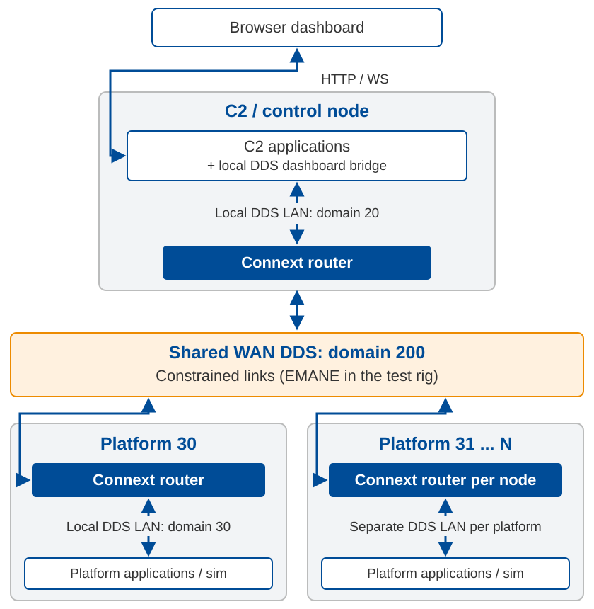

# Current system

**One Routing Service gateway per node:** local applications keep their own topics; selected traffic crosses the WAN.

---

# Three WAN topics, three delivery rules

| Topic | What it carries | WAN delivery rule |
|---|---|---|
| **Event** | Mission, Team, command acknowledgments | **Reliable, keep all:** older events still matter |
| **State** | ContactReport updates | **Reliable, keep latest per contact on the writer:** newer state replaces older state |
| **Periodic** | Position, power, RouterHealth | **Best effort, keep latest:** a fresh sample matters more than a retry |

> **Why split them?** Contact updates can replace each other without replacing commands. Periodic readings don't add repair traffic.

<!--
One WAN reader/writer pair per topic per gateway. Event keeps all on both ends.
State keeps one value per instance on the writer; its reader keeps all.
Periodic keeps one value per instance on both ends. All three are volatile.
Reliable delivery is not unlimited history or restart replay.
Sources: ../../router/routing_service/README.md and ../../harness_v2/qos/act_qos_profiles.xml.
-->

---

# Contact report spike: why State needed its own topic

**Scenario:** A two-minute WAN outage in a workload with 14,561 contact writes and 180 commands.

| What we tried | What happened after reconnect |
|---|---|
| **Share Event and keep every update** | All 180 commands were acknowledged, but contacts took **60.3 s** to catch up. |
| **Share Event and keep only the latest** | Contacts caught up in **12.9 s**, but **120 of 180 command acknowledgments were missing**. |
| **Separate State from Event** | Contacts caught up in **19.1 s** and all **180 commands** were acknowledged. |

> **Decision:** Keep every command and acknowledgment on Event. On State, let a newer update replace an older one for the same contact.

The split still missed the **10 s** contact recovery target in this isolated test.

<!--
Historical prototype results, not a live mesh benchmark or a restart recovery
guarantee. The 14,561 count is valid data writes; the workload also exercised
contact disposals. The shared keep-latest trial changed writer history on the
512 KiB repair candidate; the split prototype was a separate run. The split
recovered the correct final contact set without replaying every update.
Sources: ../two-topic-wan-migration-plan.md (sections 3.32, 3.34 and 3.35)
and ../../spikes/three_topic_wan/README.md.
-->

---

# Six priority channels share one send budget

| WAN topic | High | Normal |
|---|---|---|
| **Event** | **600** · Mission, command acknowledgments | **300** · normal events |
| **State** | **400** · high-priority state | **200** · ContactReport |
| **Periodic** | **500** · RouterHealth | **100** · routine telemetry |

> **Higher goes first.** A health report can go ahead of routine contacts without needing its own DDS topic.

The three writers share a nominal **2 Mbps** pacing budget per gateway, not a radio airtime limit.

<!--
Each binding's channel selects a WAN topic and sample priority, not a separate
DDS endpoint. The asynchronous writers use the shared act_rs Highest Priority
First flow controller. DDSPRIFLTR separates high and normal lanes on each
writer; the single-lane experiment showed sample priority alone didn't let an
urgent sample overtake that writer's queued backlog. This is a scheduling
preference, not a guarantee of latency or airtime.
Sources: bandwidth-optimization.md and ../../router/routing_service/README.md.
-->

---

# Data prioritization: four network tiers

| Tier | Traffic class | Example DSCP | Intended behavior as capacity drops |
|---|---|---|---|
| **1 · Highest** | Network control and voice | CS6 (48), EF (46) | Serve first; bound the voice load |
| **2 · High** | Interactive messages and telemetry | AF41 (34), CS4 (32) | Keep small, time-sensitive updates moving |
| **3 · Medium** | Streaming media | AF31 (26), AF21 (18) | Reduce stream quality before delaying interactive traffic |
| **4 · Lowest** | Bulk transfers and logs | Default (0) | Use spare capacity; defer under load |

**Today:** Three DDS topics share a **2 Mbps** sample scheduler. Network tiers are a separate policy, not four DDS topics.

> **Keep three for now.** Six topics added **34%** discovery traffic in the UDPv6 spike. EMANE RF Pipe preserved the marks but showed no priority benefit.

<!--
The four tiers are a proposed generic traffic policy, not a deployed
configuration. DSCP marks do not enforce service or preempt a packet already
being transmitted. The bottleneck must classify and schedule traffic for
the intended behavior to apply. The flow controller orders queued DDS samples
before transmission; it does not mark IP packets. The six-topic option would
split Event, State and Periodic into High and Normal writers for writer-level
packet marking. It does not imply a one-to-one mapping between topics and tiers.

Discovery comparison: seven standalone DDS participants, five cold starts
per case, SPDP2 + SEDP unicast on loopback. UDPv6 discovery traffic rose from
232 to 311 kB (median IP bytes over the first three seconds). Median time
to match every remote endpoint was 1.02 vs. 1.04 s.
UDPv6 SEDP bytes increased 60%; total discovery packet count increased 2%.
UDPv4 control: 211 to 288 kB (+37%), 1.013 to 1.028 s to match.
A separate marking probe captured IPv6 Traffic Class 0x00 and 0xB8
(DSCP 0 and 46). A separate two-node EMANE RF Pipe overload test preserved
the marks, but both classes delivered about 22% and showed no consistent
latency advantage. The discovery comparison did not run Routing Service
or EMANE. The full four-tier policy has not been tested.
Source: ../../spikes/wan_topic_discovery/README.md.
-->

---

# Typed unions vs. binary payloads

| | Typed union · deployed | Binary envelope · tested in isolation |
|---|---|---|
| **What crosses** | A typed branch carries the full original sample | A fixed header carries serialized payload bytes |
| **What DDS can see** | Header and typed payload fields | Header only; a codec must decode the payload |
| **What must agree** | Gateways use compatible union definitions | Gateways share an envelope format; decoding still needs the original type |

> **Why use unions today?** Keep the payload typed and inspectable. Binary can keep application type definitions off the WAN, but it doesn't remove the need to manage schemas.

<!--
Prepared XML supplies the current compatible types and bindings; this is not
automatic runtime union discovery. Binary experiments used typed outer
metadata for audience filtering. Binary is not automatically smaller on the
wire, and isolated forwarding/compression is not ACT integration.
Sources: wan-schema-propagation-options.md, bandwidth-optimization.md, and
../../spikes/binary_wan_compression/README.md.
-->

---

# QoS: infer locally, configure the WAN

| Where | How Routing Service configures it |
|---|---|
| **Application LAN routes** | Start routes independently when a matching local app appears. Native auto-QoS infers supported settings from that endpoint. |
| **Shared WAN hub** | Starts immediately. Explicit XML profiles set reliability, history, deadlines and pacing; auto-QoS is off. |

> **Why split them?** Missing apps don't block health or other routes, and local app settings don't change the WAN delivery rules.

<!--
LAN routes use ON_DOMAIN_MATCH with auto_configure_qos=true. Native tests
showed LAN input reliability/durability inference and LAN output durability
inference. Finite output deadlines, retention and resource budgets still
need explicit XML. WAN ports use IMMEDIATE with auto-QoS off.
Source: ../../router/routing_service/README.md#native-lan-auto-qos-qualification.
-->

---

<!-- _class: compact isolation-matrix -->

# Isolation mechanisms

| Mechanism | Network | Discovery | Logical | Runtime changeable | Network bandwidth impact |
|---|:---:|:---:|:---:|:---:|---|
| VLANs / firewall rules | Network paths | — | — | Network admin | Limits discovery + data reach |
| Domain ID | Port ranges | Participant + endpoint | — | — | Scopes discovery + data |
| Domain tag | — | Participant + endpoint | — | — | Less endpoint discovery + data |
| DomainParticipant partitions | — | Participant + endpoint | Subsystem / team | Application | Less endpoint discovery + data |
| Publisher/Subscriber partitions | — | — | Groups of topics | Application | Less data; discovery remains |
| Topics | — | — | Topic | — | Discovery per endpoint; data per match |
| Content filters | — | — | Sample | Application | Less data if sender-filtered |
| Union discriminator | — | — | Sample (variant) | Application | Fewer endpoints: less discovery |

**Runtime changeable:** no DDS entity recreation.
**Bandwidth:** endpoint count drives discovery; sender-side selection reduces user data.

---

<!-- _class: compact -->

# Two strategies for data filtering

| | Control exposure | Control interest |
|---|---|---|
| Driver | Source controls data availability | User controls scope / filter of available data |
| Control | Enable additional routes or reporting topics | Expand subscriptions or content-filter criteria |
| Example | Enable routes based on mission state | Request data based on teams or location |
| Benefit | Explicit control over what may leave a node | Each reader selects what it needs |
| Trade-off | Broader exposure can increase WAN traffic | WAN savings require interest to be applied upstream, not just after receipt |

**Use both:** routes define what is available; reader interest selects within that boundary.

A reader request does not, by itself, enable a disabled route.

<!--
The deployed Routing Service mesh keeps outgoing platform reports enabled.
Local mission state changes the platform's receive filters: Init receives Mission,
Team and required system traffic; ActiveMission adds fleet positions plus
same-team mission status and contacts. Other eligible readers can still receive
their copies. This is a DDS filter update, not a separate request protocol.
-->

---

<!-- _class: compact -->

# Discovery options

| Option | How peers are found | Benefit | Trade-off |
|---|---|---|---|
| Multicast | Announce to a shared multicast group | No peer address list needed | Requires a multicast-capable network |
| Unicast: configured peers | Contact a fixed list of peer addresses | Works without multicast or a central server | Must update peer lists when deployments change |
| Cloud Discovery Service (CDS) | Central RTI service introduces participants | Dynamic discovery without a custom directory | Must run a reachable discovery service |
| Unicast: bootstrap directory | Control (e.g., C2) supplies peer addresses at runtime | Start with one bootstrap address, not the full roster | Application owns directory updates and recovery |

**Bootstrap:** knowing one ordinary DDS participant does not automatically reveal its peers.

---

# DDIL link-health measurement options

| Measurement | Simple approach | What it tells us |
|---|---|---|
| Peer presence | Track existing health heartbeats | Is the peer reachable? |
| Round-trip time (RTT) | Acknowledge a heartbeat in the next heartbeat; subtract the reporting wait | How long is the round trip? |
| DDS protocol counters | Track per-peer repairs and unacknowledged data | Is reliable delivery under pressure? |

**Reuse existing traffic. Show how fresh each measurement is.**

Presence, delay, and delivery pressure are separate facts, not a single health score.
