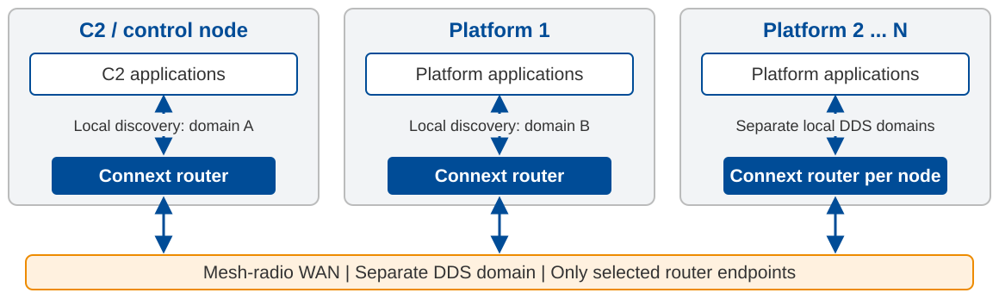

# 1. Isolate local discovery with a router

> **Start here:** do not carry every local application's discovery over the radio.

---

# 2. Reduce what the WAN announces

| Lever | What it reduces |
|---|---|
| Fewer WAN participants and endpoints | The number of discovery announcements |
| Disable type propagation for Connext < 7.7 | Type definitions carried in discovery |
| Fewer shared WAN topics | Endpoint discovery, when they replace many per-topic endpoints |

**Before disabling types:** provide compatible type definitions at every WAN consumer.
Applications and tools that learn types dynamically still need type propagation.

> **Separate the levers:** content filters reduce selected user data;
> they do not remove the endpoints from discovery.

---

<!-- _class: compact -->

# 3. Choose multicast or unicast discovery

| | Multicast | Unicast |
|---|---|---|
| How | Announce to a shared group | Contact configured peer addresses |
| Gain | No per-platform address roster | Works without multicast |
| Cost | Radio must support efficient, reliable multicast | Maintain contacts; announcements may be sent to multiple peers |
| Best fit | Mesh with proven multicast behavior | Mesh where multicast is unavailable or costly |

**Discovery multicast does not require user-data multicast.**

> **Measure on the radio:** compare airtime and discovery/recovery time.
> Neither option is automatically cheaper on a multi-hop mesh.

---

<!-- _class: compact -->

# 4. If unicast, choose how peers get addresses

| Strategy | Simple model | Main trade-off |
|---|---|---|
| Configured peers | Load known peer addresses | Simple baseline; update when addresses change |
| C2 directory | Mission control supplies peer addresses | Application owns directory updates and recovery |
| Cloud Discovery Service (CDS) | RTI service introduces participants | Operate a reachable rendezvous service |

**C2 and CDS help peers find each other; they are not user-data relays.**
Knowing one ordinary DDS peer does not automatically reveal its peers.

> **Practical sequence:** isolate -> reduce announcements -> choose transport -> choose peer setup.
> Validate with the same fleet size, loss, and restart scenarios.
