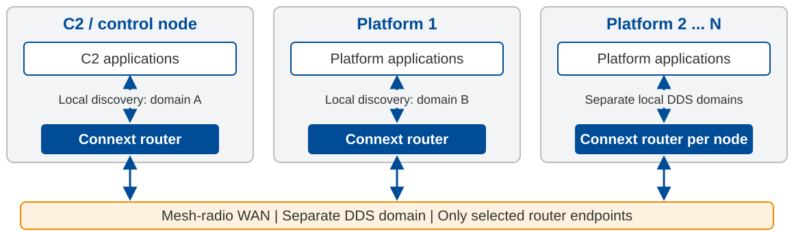

# 1. Isolate local discovery with a router

> **Start here:** do not carry every local application's discovery over the radio.

---

# 2. Reduce what the WAN announces

| Lever | What it reduces |
|---|---|
| Fewer WAN participants and endpoints | The number of discovery announcements |
| Disable type propagation for Connext < 7.7 | Type definitions carried in discovery |
| Fewer shared WAN topics | Endpoint discovery, when they replace many per-topic endpoints |

**Before disabling types:** provide compatible type definitions at every WAN consumer.
Applications and tools that learn types dynamically still need type propagation.

> **Separate the levers:** content filters reduce selected user data;
> they do not remove the endpoints from discovery.

---

<!-- _class: compact -->

# Static endpoints: tested, not suitable for our WAN

**Limited Bandwidth Endpoint Discovery (LBED)** removes SEDP endpoint announcements.
Routing Service forwards binary envelopes with SPDP2 + LBED.

Test: offer **3 samples per phase**; change the filter to select **1, 2, 3, then 1**.

| Discovery | Correct receiver deliveries | Samples crossing WAN |
|---|---|---|
| SPDP2 + SEDP | 1, 2, 3, 1 | **1, 2, 3, 1** |
| SPDP2 + LBED | 1, 2, 3, 1 | **3, 3, 3, 3** |

LBED behaves the same with or without an initial filter in its static catalog.

> **Decision: do not use LBED for our WAN.** We need dynamic sender-side
> audience filtering, not receiver-only discard after using radio bandwidth.

<!--
Measured 2026-11-20 with actual Connext 7.7.0 Routing Service processes.
Detailed evidence: ../../spikes/routing_service_lbed/README.md,
section "Dynamic CFT follow-up (2026-11-20)".
Three variants: SEDP control, LBED with initial narrow CFT in the catalog,
and LBED without a catalog CFT. All use SPDP2 participant discovery.
The same reliable Event input is expanded and narrowed through native remote
administration. Nine UPDATEs and 12 GETs succeeded, with parameter readback.
All 12 phases have correct local selection: 36 offered envelopes and 21 exact
selected deliveries. Captures independently count unique WAN DATA sequences.
Reader GUIDs remain unchanged; zero capture drops and native ERROR/FATAL lines.
Both LBED WAN captures contain zero SEDP submessages. Separate administration
domain 113 still uses dynamic discovery and is outside the WAN capture.
The binary envelope itself works; it does not restore sender-side filtering.
This rejects LBED for our current WAN audience-filtering requirement, not every
static-discovery use case. No production configuration or runtime was changed.
Reproduce: bash spikes/routing_service_lbed/run.sh --cft
The feature gate intentionally returns 1: DYNAMIC_WRITER_FILTERING_NOT_OBSERVED.
-->

---

<!-- _class: compact -->

# 3. Choose multicast or unicast discovery

| | Multicast | Unicast |
|---|---|---|
| How | Announce to a shared group | Contact configured peer addresses |
| Gain | No per-platform address roster | Works without multicast |
| Cost | Radio must support efficient, reliable multicast | Maintain contacts; announcements may be sent to multiple peers |
| Best fit | Mesh with proven multicast behavior | Mesh where multicast is unavailable or costly |

**Discovery multicast does not require user-data multicast.**

> **Measure on the radio:** compare airtime and discovery/recovery time.
> Neither option is automatically cheaper on a multi-hop mesh.

---

<!-- _class: compact -->

# 4. If unicast, choose how peers get addresses

| Strategy | Simple model | Main trade-off |
|---|---|---|
| Configured peers | Load known peer addresses | Simple baseline; update when addresses change |
| C2 directory | Mission control supplies peer addresses | Application owns directory updates and recovery |
| Cloud Discovery Service (CDS) | RTI service introduces participants | Operate a reachable rendezvous service |

**C2 and CDS help peers find each other; they are not user-data relays.**
Knowing one ordinary DDS peer does not automatically reveal its peers.

> **Practical sequence:** isolate -> reduce announcements -> choose transport -> choose peer setup.
> Validate with the same fleet size, loss, and restart scenarios.
